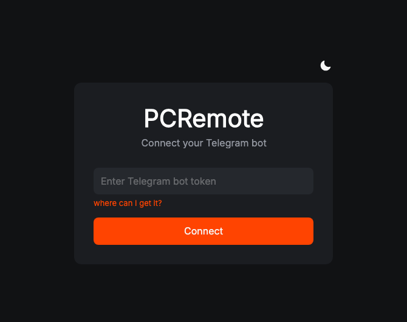
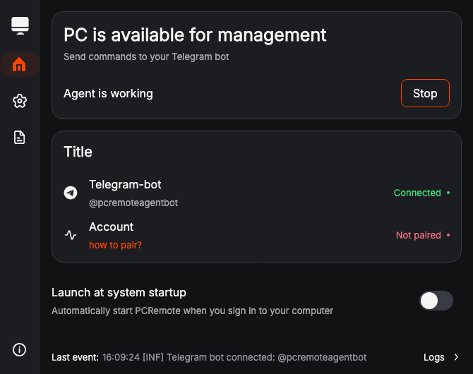
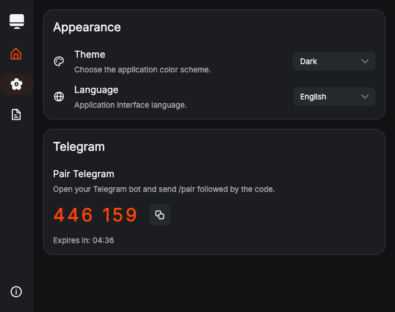
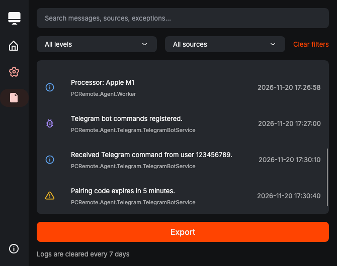
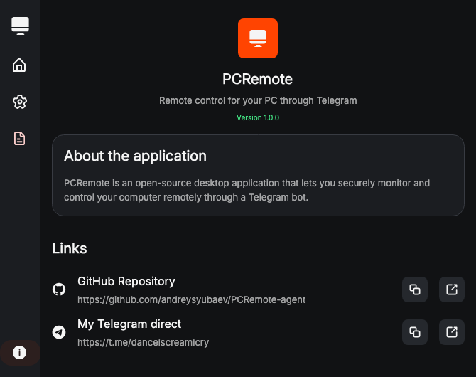

# PCRemote

> Language: **English** | [Русский](README.ru.md)

**PCRemote** is a desktop application and background agent for **Windows** and **macOS** that let you control your computer through a personal Telegram bot.

The app shows agent and bot status, helps you pair a Telegram account, stores the bot token in OS-protected storage, writes local logs and displays them in the UI. The agent runs in the same process as the desktop application, but it can also be started separately as a .NET Worker.

Version: **1.0.0**.

## Contents

- [Features](#features)
- [Screenshots](#screenshots)
- [How it works](#how-it-works)
- [Requirements](#requirements)
- [Installation and run](#installation-and-run)
- [First-time Telegram setup](#first-time-telegram-setup)
- [Bot commands](#bot-commands)
- [Settings and data storage](#settings-and-data-storage)
- [Stack](#stack)
- [Project structure](#project-structure)
- [Packages](#packages)
- [Development](#development)
- [Release build](#release-build)
- [Troubleshooting](#troubleshooting)
- [Links](#links)

## Features

### Desktop application

- Connects a Telegram bot using a token from [@BotFather](https://t.me/BotFather).
- Pairs a Telegram account with a six-digit code that is valid for **5 minutes**.
- Home page: agent status, bot status, pairing code, last event and autostart toggle.
- Settings page: light/dark/system theme, `System` / `English` / `Russian` language, pairing code and bot disconnect.
- Logs page: viewing, search, filters by level and source, auto-refresh and export.
- About page: version, repository and author contact.
- EN/RU localization via `.resx`; UI strings are not hardcoded in XAML or code.
- Tray support: `Open`, `Start Agent`, `Stop Agent`, `Exit`. Closing the window hides the app to the tray instead of exiting it.
- Protection against a second instance via a `.single-instance.lock` file in the app data directory.
- Background launch with the `--minimized` argument (used by autostart).

### Agent

- Runs as a `Microsoft.Extensions.Hosting` Worker and uses Telegram long polling (`30 s`, retry after `5 s` on error).
- Accepts commands only from the paired Telegram user; messages from other users are ignored and logged.
- Reports agent state to the UI: running, bot connected, account paired, pairing code and its lifetime.
- Logs the OS, OS version, CPU, GPU, RAM and free disk space at startup.
- Writes logs to the local app directory: daily rotation, up to **7** files, **10 MB** per file.
- Supports Windows and macOS; on other operating systems platform service registration ends with `PlatformNotSupportedException`.

## Screenshots

The images are headless renders of the real XAML pages produced with Avalonia and Skia. The screenshots use demo logs and a test pairing code.

| | Screen |
|---|---|
| <a href="docs/screenshots/00-setup.png"></a> | **Setup** — Telegram bot token input and the built-in BotFather guide |
| <a href="docs/screenshots/01-home.png"></a> | **Home** — agent state, pairing code and autostart |
| <a href="docs/screenshots/02-settings.png"></a> | **Settings** — theme, language, pairing code and bot disconnect |
| <a href="docs/screenshots/03-logs.png"></a> | **Logs** — search, filters and event list |
| <a href="docs/screenshots/04-about.png"></a> | **About** — application information and links |

## How it works

1. You create a bot with [@BotFather](https://t.me/BotFather) and get an API token.
2. The app validates the token through `Telegram.Bot` and saves it in OS-protected storage.
3. The agent starts long polling and generates a six-digit pairing code for 5 minutes.
4. You send `/pair <code>` to the bot; the app saves the `Telegram Allowed User ID`.
5. After that, the bot accepts only your commands. Dangerous actions require additional button confirmation within **2 minutes**.

## Requirements

To run from source:

- [.NET 10 SDK](https://dotnet.microsoft.com/download/dotnet/10.0)
- Windows or macOS
- A Telegram account and a bot created with BotFather

Ready-made release archives do not require the .NET SDK: the builds are published as self-contained.

To build a release on macOS you also need `zip`, `ditto`, `shasum` and `file`; `hdiutil` is required only when `CREATE_DMG=1`.

## Installation and run

### Ready-made release

1. Download an archive from the [v1.0.0](https://github.com/andreysyubaev/PCRemote-agent/releases/tag/v1.0.0) page:
   - `PCRemote-1.0.0-macos-osx-arm64.zip` — macOS, Apple Silicon;
   - `PCRemote-1.0.0-macos-osx-x64.zip` — macOS, Intel;
   - `PCRemote-1.0.0-windows-win-x64.zip` — Windows x64.
2. Extract the archive and run `PCRemote.Desktop` / `PCRemote.Desktop.exe`.
3. Verify the checksums if you downloaded `SHA256SUMS.txt`:

   ```bash
   shasum -a 256 -c SHA256SUMS.txt
   ```

The macOS bundle is ad-hoc signed. If Gatekeeper blocks the first launch, open the app via right-click → **Open**.

### From source

```bash
git clone https://github.com/andreysyubaev/PCRemote-agent.git
cd PCRemote-agent

dotnet build PCRemote.sln
dotnet test PCRemote.sln --no-build --nologo -v minimal

dotnet run --project src/PCRemote.Desktop/PCRemote.Desktop.csproj
```

To start without a window:

```bash
dotnet run --project src/PCRemote.Desktop/PCRemote.Desktop.csproj -- --minimized
```

## First-time Telegram setup

1. Open [@BotFather](https://t.me/BotFather), send `/newbot` and create a bot.
2. Copy the API token it gives you.
3. On the first launch, PCRemote opens the **Setup** screen. Paste the token into the **Bot token** field and click **Connect bot**. A step-by-step guide is available inside the app.
4. Open your bot in Telegram and send `/start`.
5. On the home page or in **Settings**, copy the pairing code and send it to the bot:

   ```text
   /pair 446159
   ```

   Use your current code instead of `446159`. The code is valid for 5 minutes; a new one is generated after it expires.
6. Make sure the bot status changes to **Paired**. To switch accounts, send `/unpair` to the bot and pair again.

Do not share your bot token with third parties: it gives full control over the bot.

## Bot commands

| Command | Action |
|---|---|
| `/start` | Main menu with action buttons |
| `/help` | Help and feature list |
| `/pair <code>` | Pair the Telegram account with the computer |
| `/unpair` | Unpair the current account and generate a new code |
| `/status` | System information: OS, version, CPU, GPU, RAM, free space |
| `/screenshot` | Take a screenshot of the computer desktop |
| `/shutdown` | Shut down the PC after confirmation |
| `/restart` | Restart the PC after confirmation |
| `/sleep` | Put the PC to sleep after confirmation |

The buttons in the bot menu duplicate the main commands. Confirmation for `/shutdown`, `/restart` and `/sleep` is valid for 2 minutes and is available only to the paired user.

## Settings and data storage

`<LocalApplicationData>` in the table below means `%LOCALAPPDATA%` on Windows and `~/Library/Application Support` on macOS.

| Item | Location |
|---|---|
| App data directory | `<LocalApplicationData>/PCRemote` |
| Logs | `<LocalApplicationData>/PCRemote/Logs/pcremote-*.log` |
| UI language | `<LocalApplicationData>/PCRemote/language.txt` |
| Theme | `<LocalApplicationData>/PCRemote/theme.txt` |
| Second-instance lock | `<LocalApplicationData>/PCRemote/.single-instance.lock` |
| Bot token and user ID, macOS | Keychain, service `PCRemote`, keys `TelegramBotToken` and `TelegramAllowedUserId` |
| Bot token and user ID, Windows | `<LocalApplicationData>/PCRemote/secrets.dat`, DPAPI encryption |
| Autostart, Windows | `HKCU\Software\Microsoft\Windows\CurrentVersion\Run` |
| Autostart, macOS | `~/Library/LaunchAgents/com.pcremote.desktop.plist` |

Language supports `System`, `ru` and `en`; theme supports `Light`, `Dark` and `System`. If no settings file exists, the system language is used: `ru` when the installed UI culture is Russian, otherwise `en`.

## Stack

| Area | Technology |
|---|---|
| Language and runtime | C#, .NET 10 |
| UI | Avalonia 12.1.6, Fluent Theme, Inter |
| MVVM | CommunityToolkit.Mvvm 8.4.2 |
| DI and hosted services | Microsoft.Extensions.Hosting 10.0.14 |
| Telegram | Telegram.Bot 22.10.3.3 |
| Logging | Serilog.Extensions.Hosting 10.0.0, Serilog.Sinks.File 7.0.0 |
| UI icons | Svg.Controls.Skia.Avalonia 12.0.0.17 |
| Tests | xUnit 2.9.3, Microsoft.NET.Test.Sdk 17.14.1, coverlet.collector 6.0.4 |
| Secret protection | macOS Keychain via `security`, Windows DPAPI via `System.Security.Cryptography.ProtectedData` 10.0.0 |
| Release | Bash scripts, `dotnet publish`, `ditto`, `zip`, `hdiutil`, `shasum` |

## Project structure

```text
PCRemote/
├── PCRemote.sln
├── scripts/
│   ├── build-release.sh        # release archives for macOS and Windows
│   └── publish-mac.sh          # .app bundle for macOS
├── docs/screenshots/           # screenshots used in this README
├── src/
│   ├── PCRemote.Core/          # models, interfaces, shared contracts
│   ├── PCRemote.Agent/         # Telegram bot, agent runtime, logging
│   ├── PCRemote.Platform.MacOS/   # Keychain, autostart, system info
│   ├── PCRemote.Platform.Windows/  # DPAPI, autostart, system info
│   └── PCRemote.Desktop/       # Avalonia UI, view models, localization, styles
└── tests/
    └── PCRemote.Tests/         # xUnit tests
```

## Packages

### `PCRemote.Desktop`

- `Avalonia` — `12.1.6`
- `Avalonia.Desktop` — `12.1.6`
- `Avalonia.Themes.Fluent` — `12.1.6`
- `Avalonia.Fonts.Inter` — `12.1.6`
- `AvaloniaUI.DiagnosticsSupport` — `2.2.3` (Debug only)
- `CommunityToolkit.Mvvm` — `8.4.2`
- `Microsoft.Extensions.Hosting` — `10.0.14`
- `Svg.Controls.Skia.Avalonia` — `12.0.0.17`

### `PCRemote.Agent`

- `Microsoft.Extensions.Hosting` — `10.0.14`
- `Serilog.Extensions.Hosting` — `10.0.0`
- `Serilog.Sinks.File` — `7.0.0`
- `Telegram.Bot` — `22.10.3.3`

### `PCRemote.Platform.Windows`

- `System.Security.Cryptography.ProtectedData` — `10.0.0`

### `PCRemote.Tests`

- `coverlet.collector` — `6.0.4`
- `Microsoft.NET.Test.Sdk` — `17.14.1`
- `xunit` — `2.9.3`
- `xunit.runner.visualstudio` — `3.1.4`

`PCRemote.Core` and `PCRemote.Platform.MacOS` have no external NuGet dependencies.

## Development

Build and tests:

```bash
dotnet build PCRemote.sln
dotnet test PCRemote.sln --no-build --nologo -v minimal
```

At the time of writing: the build completes with `0` warnings and `0` errors, tests are `26/26`.

When adding UI text, use the resources in `Localization/Strings.resx` and `Localization/Strings.ru.resx` and the key from `LocalizationManager.GetString(...)`.

## Release build

The release script runs on macOS and creates archives in `artifacts/release/<VERSION>/`:

```bash
./scripts/build-release.sh

VERSION=1.0.1 ./scripts/build-release.sh
CREATE_DMG=1 ./scripts/build-release.sh
```

Standalone macOS bundle build:

```bash
./scripts/publish-mac.sh
RID=osx-x64 ./scripts/publish-mac.sh
```

Environment variables:

| Variable | Purpose | Default |
|---|---|---|
| `VERSION` | Release version | `1.0.0` |
| `MAC_RIDS` | macOS RIDs | `osx-arm64 osx-x64` |
| `WINDOWS_RIDS` | Windows RIDs | `win-x64` |
| `CREATE_DMG` | Also create `.dmg` files | `0` |
| `MAC_SIGN_IDENTITY` | Real signing identity for `.app`; ad-hoc without it | — |
| `RELEASE_DIR` | Output directory | `artifacts/release/<VERSION>` |
| `RID` | RID for `publish-mac.sh` | `osx-arm64` |
| `CONFIGURATION` | Build configuration | `Release` |
| `SELF_CONTAINED` | Self-contained publish | `true` |
| `OUTPUT_DIR` | Output directory for `publish-mac.sh` | `artifacts/mac/<RID>` |

The script also creates `SHA256SUMS.txt` and `RELEASE_NOTES.md`.

## Troubleshooting

| Symptom | What to check |
|---|---|
| Bot does not reply | Agent is running (Home), token is saved, network is available, the chat with the bot is open in Telegram |
| `Invalid Telegram bot token` | The token was copied in full and has not been revoked in @BotFather; reconnect in Setup/Settings |
| Pairing code is rejected | The code is valid for 5 minutes; send `/pair` with the current code from the app |
| Bot replies but commands do nothing | Send `/unpair` and pair again; check the paired user ID |
| The app does not open | It may already be running and hidden in the tray; check the system tray icon |
| macOS blocks the launch | Right-click the app and choose **Open** |
| More details are needed | Open the **Logs** page or the files in `<LocalApplicationData>/PCRemote/Logs` |

Dangerous commands (`/shutdown`, `/restart`, `/sleep`) always require button confirmation in Telegram.

## Links

- Repository: <https://github.com/andreysyubaev/PCRemote-agent>
- v1.0.0 release: <https://github.com/andreysyubaev/PCRemote-agent/releases/tag/v1.0.0>
- Contact the author: <https://t.me/danceiscreamicry>
