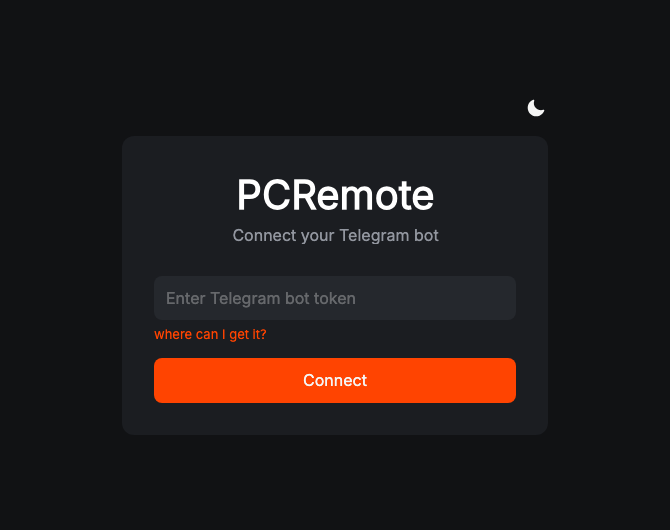
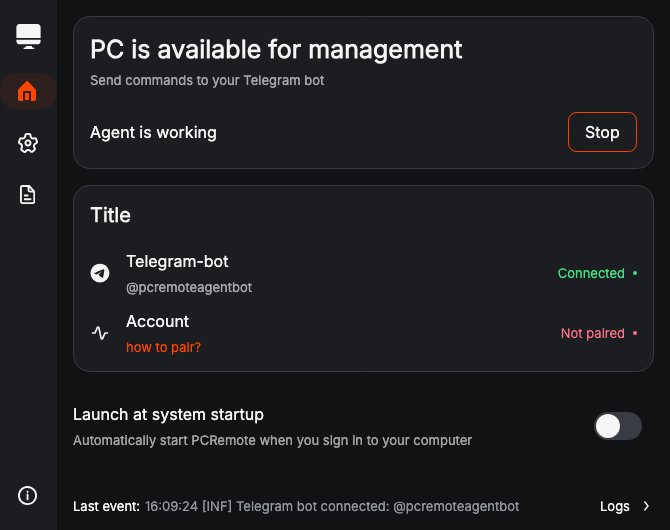
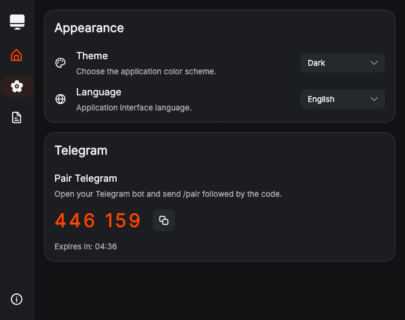
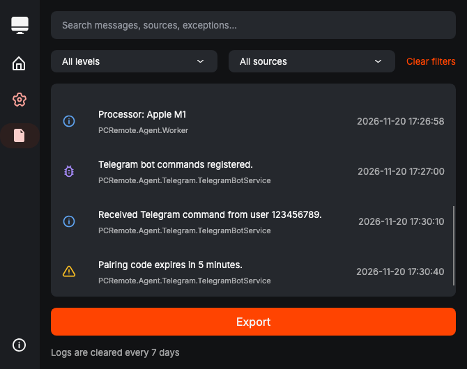
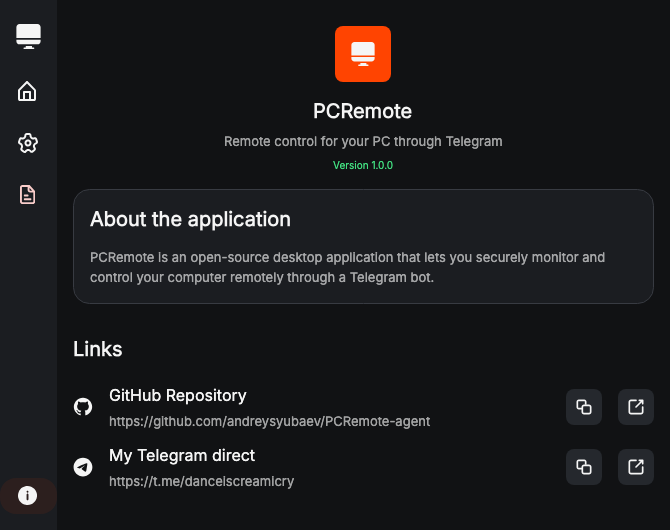

# PCRemote

> Язык: [English](README.md) | **Русский**

**PCRemote** — десктопное приложение и фоновый агент для **Windows** и **macOS**, которые позволяют управлять компьютером через личного Telegram-бота.

Приложение показывает состояние агента и бота, помогает привязать Telegram-аккаунт, хранит токен в защищённом хранилище ОС, ведёт локальные логи и показывает их в интерфейсе. Агент работает в том же процессе, что и десктопное приложение, но его также можно запускать отдельно как .NET Worker.

Версия: **1.0.0**.

## Содержание

- [Возможности](#возможности)
- [Скриншоты](#скриншоты)
- [Как это работает](#как-это-работает)
- [Требования](#требования)
- [Установка и запуск](#установка-и-запуск)
- [Первая настройка Telegram](#первая-настройка-telegram)
- [Команды бота](#команды-бота)
- [Настройки и хранение данных](#настройки-и-хранение-данных)
- [Стек](#стек)
- [Структура проекта](#структура-проекта)
- [Пакеты](#пакеты)
- [Разработка](#разработка)
- [Сборка релиза](#сборка-релиза)
- [Диагностика](#диагностика)
- [Ссылки](#ссылки)

## Возможности

### Десктопное приложение

- Подключение Telegram-бота по токену, полученному у [@BotFather](https://t.me/BotFather).
- Привязка аккаунта Telegram шестизначным кодом, действующим **5 минут**.
- Главная страница: статус агента, статус бота, код привязки, последнее событие, переключатель автозапуска.
- Страница настроек: светлая/тёмная/системная тема, язык `System` / `English` / `Russian`, код привязки, отключение бота.
- Страница логов: просмотр, поиск, фильтры по уровню и источнику, автообновление, экспорт.
- Страница «О приложении»: версия, репозиторий, контакт автора.
- Локализация EN/RU через `.resx`; строки интерфейса не захардкожены в XAML/коде.
- Работа в трее: `Open`, `Start Agent`, `Stop Agent`, `Exit`. Закрытие окна скрывает приложение в трей, а не завершает его.
- Защита от второго экземпляра: файловая блокировка `.single-instance.lock` в каталоге данных приложения.
- Запуск в фоне через аргумент `--minimized` (используется автозапуском).

### Агент

- Работает как `Microsoft.Extensions.Hosting` Worker, использует long polling Telegram (`30 s`, повтор при ошибке через `5 s`).
- Принимает команды только от привязанного Telegram-пользователя; чужие сообщения игнорируются и логируются.
- Передаёт состояние агента в UI: запущен, бот подключён, аккаунт привязан, код и время его жизни.
- При старте логирует ОС, версию ОС, процессор, видеокарту, объём RAM и свободное место на диске.
- Пишет логи в локальный каталог приложения: ежедневная ротация, до **7** файлов, до **10 MB** на файл.
- Поддерживает Windows и macOS; для других ОС регистрация платформенных сервисов завершается `PlatformNotSupportedException`.

## Скриншоты

Изображения — headless-рендер реальных XAML-страниц приложения через Avalonia + Skia. На скриншотах используются демонстрационные логи и тестовый код привязки.

| | Экран |
|---|---|
| <a href="docs/screenshots/00-setup.png"></a> | **Setup** — ввод токена Telegram-бота и встроенная инструкция по BotFather |
| <a href="docs/screenshots/01-home.png"></a> | **Home** — состояние агента, код привязки и автозапуск |
| <a href="docs/screenshots/02-settings.png"></a> | **Settings** — тема, язык, код привязки и отключение бота |
| <a href="docs/screenshots/03-logs.png"></a> | **Logs** — поиск, фильтры и список событий |
| <a href="docs/screenshots/04-about.png"></a> | **About** — информация о приложении и ссылки |

## Как это работает

1. Вы создаёте бота у [@BotFather](https://t.me/BotFather) и получаете API-токен.
2. Приложение проверяет токен через `Telegram.Bot` и сохраняет его в защищённом хранилище ОС.
3. Агент запускает long polling и генерирует шестизначный код привязки на 5 минут.
4. Вы отправляете боту `/pair <код>`; приложение сохраняет `Telegram Allowed User ID`.
5. После этого бот принимает только ваши команды. Опасные действия дополнительно подтверждаются кнопками в течение **2 минут**.

## Требования

Для запуска из исходников:

- [.NET 10 SDK](https://dotnet.microsoft.com/download/dotnet/10.0)
- Windows или macOS
- Telegram-аккаунт и созданный через BotFather бот

Для готовых релизных архивов .NET SDK не нужен: сборки публикуются self-contained.

Для сборки релиза на macOS дополнительно нужны `zip`, `ditto`, `shasum`, `file` и `hdiutil` (последний — только при `CREATE_DMG=1`).

## Установка и запуск

### Готовый релиз

1. Скачайте архив со страницы [v1.0.0](https://github.com/andreysyubaev/PCRemote-agent/releases/tag/v1.0.0):
   - `PCRemote-1.0.0-macos-osx-arm64.zip` — macOS, Apple Silicon;
   - `PCRemote-1.0.0-macos-osx-x64.zip` — macOS, Intel;
   - `PCRemote-1.0.0-windows-win-x64.zip` — Windows x64, один self-contained `PCRemote.Desktop.exe`.
2. Распакуйте архив и запустите `PCRemote.Desktop` / `PCRemote.Desktop.exe`.
3. Проверьте контрольные суммы, если скачали `SHA256SUMS.txt`:

   ```bash
   shasum -a 256 -c SHA256SUMS.txt
   ```

На macOS бандл подписан ad-hoc. Если Gatekeeper блокирует первый запуск, откройте приложение через контекстное меню **Open**.

### Из исходников

```bash
git clone https://github.com/andreysyubaev/PCRemote-agent.git
cd PCRemote-agent

dotnet build PCRemote.sln
dotnet test PCRemote.sln --no-build --nologo -v minimal

dotnet run --project src/PCRemote.Desktop/PCRemote.Desktop.csproj
```

Для запуска без окна:

```bash
dotnet run --project src/PCRemote.Desktop/PCRemote.Desktop.csproj -- --minimized
```

## Первая настройка Telegram

1. Откройте [@BotFather](https://t.me/BotFather), отправьте `/newbot` и создайте бота.
2. Скопируйте выданный API-токен.
3. При первом запуске PCRemote откроется экран **Setup**. Вставьте токен в поле **Bot token** и нажмите **Connect bot**. Внутри приложения есть пошаговый guide.
4. Откройте созданного бота в Telegram и отправьте `/start`.
5. На главной странице или в **Settings** скопируйте код привязки и отправьте боту:

   ```text
   /pair 446159
   ```

   Вместо `446159` используйте свой текущий код. Код действует 5 минут; после истечения срока сгенерируется новый.
6. Убедитесь, что статус бота изменился на **Paired**. Если нужно сменить аккаунт, отправьте боту `/unpair` и выполните привязку заново.

Не передавайте токен бота третьим лицам: он даёт полный доступ к управлению ботом.

## Команды бота

| Команда | Действие |
|---|---|
| `/start` | Главное меню с кнопками действий |
| `/help` | Справка и список возможностей |
| `/pair <код>` | Привязка Telegram-аккаунта к компьютеру |
| `/unpair` | Отвязка текущего аккаунта и генерация нового кода |
| `/status` | Информация о системе: ОС, версия, CPU, GPU, RAM, свободное место |
| `/screenshot` | Скриншот рабочего стола компьютера |
| `/shutdown` | Выключение ПК после подтверждения |
| `/restart` | Перезагрузка ПК после подтверждения |
| `/sleep` | Спящий режим после подтверждения |

Кнопки в меню бота дублируют основные команды. Подтверждение для `/shutdown`, `/restart` и `/sleep` действует 2 минуты и доступно только привязанному пользователю.

## Настройки и хранение данных

`<LocalApplicationData>` в таблице ниже — это `%LOCALAPPDATA%` на Windows и `~/Library/Application Support` на macOS.

| Что | Где |
|---|---|
| Каталог данных | `<LocalApplicationData>/PCRemote` |
| Логи | `<LocalApplicationData>/PCRemote/Logs/pcremote-*.log` |
| Язык интерфейса | `<LocalApplicationData>/PCRemote/language.txt` |
| Тема | `<LocalApplicationData>/PCRemote/theme.txt` |
| Блокировка второго экземпляра | `<LocalApplicationData>/PCRemote/.single-instance.lock` |
| Токен бота и ID пользователя, macOS | Keychain, сервис `PCRemote`, ключи `TelegramBotToken` и `TelegramAllowedUserId` |
| Токен бота и ID пользователя, Windows | `<LocalApplicationData>/PCRemote/secrets.dat`, шифрование DPAPI |
| Автозапуск, Windows | `HKCU\Software\Microsoft\Windows\CurrentVersion\Run` |
| Автозапуск, macOS | `~/Library/LaunchAgents/com.pcremote.desktop.plist` |

Язык и тема поддерживают значения `System`, `ru` / `en` и `Light` / `Dark` / `System` соответственно. При отсутствии файла настроек используется системный язык: `ru`, если системная локаль русская, иначе `en`.

## Стек

| Область | Технология |
|---|---|
| Язык и runtime | C#, .NET 10 |
| UI | Avalonia 12.1.6, Fluent Theme, Inter |
| MVVM | CommunityToolkit.Mvvm 8.4.2 |
| DI и hosted services | Microsoft.Extensions.Hosting 10.0.14 |
| Telegram | Telegram.Bot 22.10.3.3 |
| Логирование | Serilog.Extensions.Hosting 10.0.0, Serilog.Sinks.File 7.0.0 |
| Иконки в UI | Svg.Controls.Skia.Avalonia 12.0.0.17 |
| Тесты | xUnit 2.9.3, Microsoft.NET.Test.Sdk 17.14.1, coverlet.collector 6.0.4 |
| Защита секретов | macOS Keychain через `security`, Windows DPAPI через `System.Security.Cryptography.ProtectedData` 10.0.0 |
| Релиз | Bash-скрипты, `dotnet publish`, `ditto`, `zip`, `hdiutil`, `shasum` |

## Структура проекта

```text
PCRemote/
├── PCRemote.sln
├── scripts/
│   ├── build-release.sh        # релизные архивы для macOS и Windows
│   └── publish-mac.sh          # .app-бандл для macOS
├── docs/screenshots/           # скриншоты из README
├── src/
│   ├── PCRemote.Core/          # модели, интерфейсы, общие контракты
│   ├── PCRemote.Agent/         # Telegram-бот, рантайм агента, логирование
│   ├── PCRemote.Platform.MacOS/   # Keychain, автозапуск, системная информация
│   ├── PCRemote.Platform.Windows/  # DPAPI, автозапуск, системная информация
│   └── PCRemote.Desktop/       # Avalonia UI, view models, локализация, стили
└── tests/
    └── PCRemote.Tests/         # xUnit-тесты
```

## Пакеты

### `PCRemote.Desktop`

- `Avalonia` — `12.1.6`
- `Avalonia.Desktop` — `12.1.6`
- `Avalonia.Themes.Fluent` — `12.1.6`
- `Avalonia.Fonts.Inter` — `12.1.6`
- `AvaloniaUI.DiagnosticsSupport` — `2.2.3` (только Debug)
- `CommunityToolkit.Mvvm` — `8.4.2`
- `Microsoft.Extensions.Hosting` — `10.0.14`
- `Svg.Controls.Skia.Avalonia` — `12.0.0.17`

### `PCRemote.Agent`

- `Microsoft.Extensions.Hosting` — `10.0.14`
- `Serilog.Extensions.Hosting` — `10.0.0`
- `Serilog.Sinks.File` — `7.0.0`
- `Telegram.Bot` — `22.10.3.3`

### `PCRemote.Platform.Windows`

- `System.Security.Cryptography.ProtectedData` — `10.0.0`

### `PCRemote.Tests`

- `coverlet.collector` — `6.0.4`
- `Microsoft.NET.Test.Sdk` — `17.14.1`
- `xunit` — `2.9.3`
- `xunit.runner.visualstudio` — `3.1.4`

`PCRemote.Core` и `PCRemote.Platform.MacOS` не имеют внешних NuGet-зависимостей.

## Разработка

Сборка и тесты:

```bash
dotnet build PCRemote.sln
dotnet test PCRemote.sln --no-build --nologo -v minimal
```

На момент написания README: сборка проходит с `0` предупреждений и `0` ошибок, тесты — `26/26`.

При добавлении текста в интерфейс используйте ресурсы `Localization/Strings.resx` и `Localization/Strings.ru.resx` и ключ из `LocalizationManager.GetString(...)`.

## Сборка релиза

Релизный скрипт запускается на macOS и создаёт архивы в `artifacts/release/<VERSION>/`:

```bash
./scripts/build-release.sh

VERSION=1.0.1 ./scripts/build-release.sh
CREATE_DMG=1 ./scripts/build-release.sh
```

Отдельная сборка macOS-бандла:

```bash
./scripts/publish-mac.sh
RID=osx-x64 ./scripts/publish-mac.sh
```

Переменные окружения:

| Переменная | Назначение | Значение по умолчанию |
|---|---|---|
| `VERSION` | Версия релиза | `1.0.0` |
| `MAC_RIDS` | RID для macOS | `osx-arm64 osx-x64` |
| `WINDOWS_RIDS` | RID для Windows | `win-x64` |
| `CREATE_DMG` | Дополнительно создать `.dmg` | `0` |
| `MAC_SIGN_IDENTITY` | Реальный идентификатор для подписи `.app`; без него ad-hoc | — |
| `RELEASE_DIR` | Каталог результата | `artifacts/release/<VERSION>` |
| `RID` | RID для `publish-mac.sh` | `osx-arm64` |
| `CONFIGURATION` | Конфигурация сборки | `Release` |
| `SELF_CONTAINED` | self-contained публикация | `true` |
| `OUTPUT_DIR` | Каталог для `publish-mac.sh` | `artifacts/mac/<RID>` |

Скрипт также создаёт `SHA256SUMS.txt` и `RELEASE_NOTES.md`.

## Диагностика

| Симптом | Что проверить |
|---|---|
| Бот не отвечает | Агент запущен (Home), токен сохранён, сеть доступна, чат с ботом открыт в Telegram |
| «Invalid Telegram bot token» | Токен скопирован полностью и не был отозван в @BotFather; повторите подключение в Setup/Settings |
| Код привязки не подходит | Код действует 5 минут; отправьте `/pair` с актуальным кодом из приложения |
| Бот отвечает, но команды не выполняются | Выполните `/unpair` и привяжитесь заново; проверьте ID привязанного пользователя |
| Приложение не открывается | Возможно, оно уже запущено и скрыто в трее; проверьте иконку в системном трее |
| macOS блокирует запуск | Откройте приложение через правый клик → **Open** |
| Нужны подробности ошибки | Откройте страницу **Logs** или файлы из `<LocalApplicationData>/PCRemote/Logs` |

Опасные команды (`/shutdown`, `/restart`, `/sleep`) всегда требуют подтверждения кнопкой в Telegram.

## Ссылки

- Репозиторий: <https://github.com/andreysyubaev/PCRemote-agent>
- Релиз v1.0.0: <https://github.com/andreysyubaev/PCRemote-agent/releases/tag/v1.0.0>
- Связь с автором: <https://t.me/danceiscreamicry>
